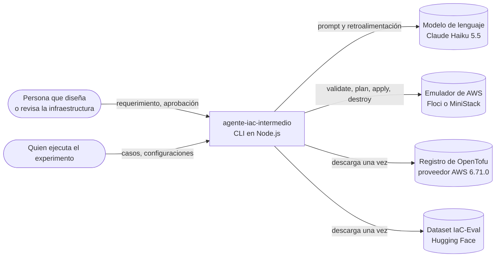
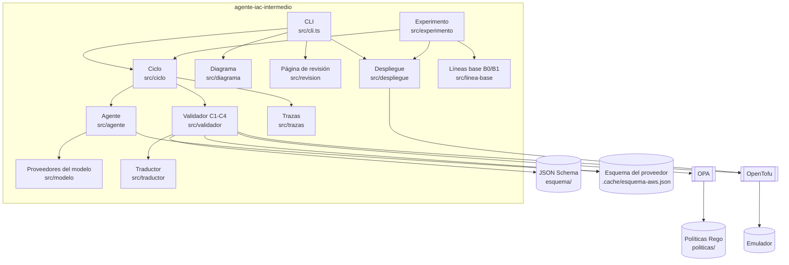
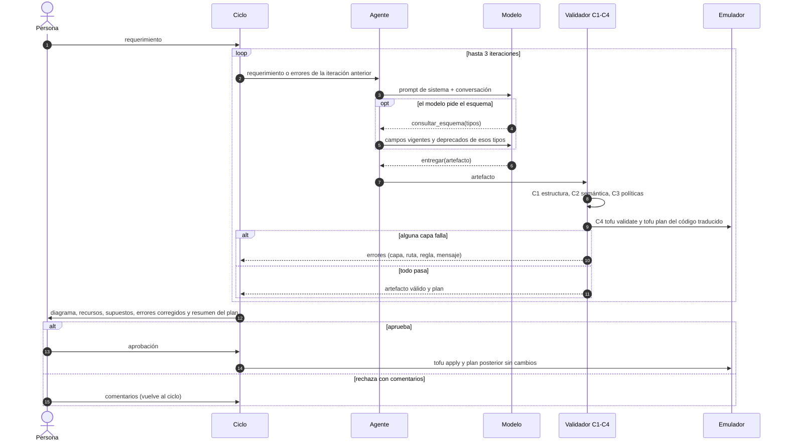

# Arquitectura

Estructura basada en arc42, resumida. Las decisiones se registran una por una en `adr/`. Los requisitos citados (RF, RNF) están en `01-requisitos.md`.

## 1. Metas

La arquitectura tiene que cumplir cuatro metas, en este orden de prioridad:

1. Que el modelo de lenguaje intervenga en un solo punto: produce el artefacto intermedio. El diagrama y el código salen de ese artefacto sin el modelo, así que no pueden contradecirse (RF-07, RF-10).
2. Que nada se despliegue sin haber pasado la validación por capas y la aprobación de una persona (RF-09, RF-11, RF-12).
3. Que ninguna llamada salga del emulador y que el costo sea mínimo y acotado (RNF-01, RNF-02).
4. Que el experimento sea reproducible y la medición igual para todas las configuraciones (RNF-04, RNF-07).

## 2. Restricciones

Despliegue solo en emulador, proveedor AWS fijado en la versión 6.71.0, software libre o gratuito y un único gasto posible: la API del modelo (R-01 a R-04 en `01-requisitos.md`).

## 3. Contexto (C4, nivel 1)

El modelo se usa de cuatro formas, según quién ejecute y quién pague (ADR-000, ADR-014, ADR-020): respuestas grabadas (sin costo), Claude Code con la sesión de un plan, la API de Anthropic con la clave de quien ejecuta, o cualquier API compatible con la de OpenAI (OpenRouter, NVIDIA, Groq u Ollama local).

## 4. Estrategia de solución

| Meta | Estrategia | ADR |
|---|---|---|
| El modelo en un solo punto | Artefacto intermedio en JSON con esquema publicado; traductor y generador de diagrama deterministas | ADR-004, ADR-005 |
| Nada sin validar | Cuatro capas de validación de la más barata a la más costosa, con retroalimentación al modelo y compuerta de revisión humana | ADR-007, ADR-008, ADR-009 |
| Conocimiento vigente del proveedor | El esquema real del proveedor (`tofu providers schema -json`) se usa a la vez como contexto del modelo y como referencia de la validación semántica | ADR-006 |
| Aislamiento y costo | Emulador local; todas las llamadas forzadas al emulador; modelo más barato y límites de gasto | ADR-001, ADR-002, ADR-018 |
| Medición justa | Mismas reglas, proveedor y requisitos de seguridad para todas las configuraciones; métricas sobre lo desplegado | ADR-019 |

## 5. Vista de bloques

### 5.1 Contenedores (C4, nivel 2)

### 5.2 Componentes y responsabilidades

| Módulo | Responsabilidad | Requisitos |
|---|---|---|
| `src/agente` | Prompt de sistema y protocolo de respuesta del modelo: consultar el esquema o entregar el artefacto | RF-02, RF-03 |
| `src/modelo` | Interfaz común de los proveedores (grabado, claude-code, anthropic, openai-compatible), tokens y costo estimado | RF-14, RNF-01 |
| `src/proveedor` | Índice del esquema del proveedor y consulta por tipo de recurso | RF-03, RF-05 |
| `src/validador/c1-estructura.ts` | C1: el artefacto cumple el JSON Schema | RF-04 |
| `src/validador/c2-semantica.ts` | C2: tipos, atributos, deprecados, referencias, dependencias y ciclos frente al esquema del proveedor | RF-05 |
| `src/validador/c3-politicas.ts` y `politicas/artefacto` | C3: políticas de seguridad sobre el artefacto | RF-06 |
| `src/traductor` | Artefacto a `main.tf.json` y configuración del proveedor apuntada al emulador | RF-07 |
| `src/validador/c4-opentofu.ts` | C4: `tofu validate` y `tofu plan` contra el emulador; ubica cada error dentro del artefacto | RF-08 |
| `src/ciclo` | Validación por capas, retroalimentación, tope de iteraciones, límite de gasto y ablaciones | RF-09, RF-15 |
| `src/diagrama` | Diagrama Mermaid del artefacto | RF-10 |
| `src/revision` | Página HTML de revisión humana | RF-11 |
| `src/despliegue` | Apply, plan posterior, diferencias cosméticas, estado y destroy | RF-12 |
| `src/trazas` | Registro JSON Lines de cada corrida | RF-13 |
| `src/linea-base` | Generación directa de OpenTofu (B0, B1) | RF-15 |
| `src/experimento` | Ejecutor reanudable, métricas M1-M6, listas de verificación (M4), políticas sobre lo desplegado (M3), IaC-Eval, estadística y resumen | RF-16, RF-17, RF-18 |
| `src/tofu.ts` | Ejecución asíncrona de OpenTofu, siempre contra el emulador | RNF-02 |
| `scripts/` | Diagnóstico, esquema del proveedor, prueba mínima y preparación de IaC-Eval | RF-19, RNF-03 |

## 6. Vista de ejecución: una corrida de la herramienta

Si las iteraciones se agotan o se alcanza el límite de gasto, la corrida termina sin desplegar nada.

## 7. Vista de despliegue

| Entorno | Componentes | Uso |
|---|---|---|
| PC con Windows, macOS o Linux | Node 22 o superior, OpenTofu 1.13.1, OPA 1.22.0, Floci en Docker o MiniStack sin Docker | Desarrollo y ejecución local |
| GitHub Codespaces | Imagen de Node 22 con Docker; `.devcontainer/` instala las herramientas verificando sus sumas y arranca Floci | Ejecución del experimento por quien paga la API, con su cuenta |
| Emulador | Floci 2.4.0 (principal) o MiniStack 1.5.36 (alternativo), en `http://localhost:4566` | Destino de todas las llamadas de OpenTofu |

## 8. Conceptos transversales

- Artefacto intermedio: recursos con el tipo real del proveedor, atributos con los nombres de OpenTofu, relaciones explícitas, propósito, requisito atendido y supuestos. Las referencias entre recursos se escriben como `${ref:id.atributo}` y el traductor las convierte. Ver `esquema/artefacto.schema.json`.
- Errores uniformes: todas las capas devuelven errores con capa, ruta (JSON Pointer), regla y mensaje en español. El mismo objeto sirve para la retroalimentación al modelo y para la página de revisión (RNF-05).
- Aislamiento: OpenTofu se ejecuta con `AWS_ENDPOINT_URL` apuntando al emulador y credenciales de prueba, de modo que también los servicios que no están en la lista de endpoints van al emulador (ADR-018).
- Configuración: todo lo variable se lee de `.env`; los valores por defecto no gastan dinero (RNF-01, RNF-03).
- Trazas: cada evento de una corrida se guarda con su tiempo; de ahí salen las métricas (RF-13).

## 9. Decisiones

| ADR | Decisión |
|---|---|
| [ADR-000](adr/ADR-000-modelo-de-costos.md) | Respuestas grabadas por defecto; gasto de API solo al ejecutar, con la cuenta de quien ejecuta |
| [ADR-001](adr/ADR-001-modelo-de-lenguaje.md) | Claude Haiku 5.5 como modelo |
| [ADR-002](adr/ADR-002-emulador.md) | Floci como emulador principal y MiniStack como réplica |
| [ADR-003](adr/ADR-003-docker.md) | Docker para Floci |
| [ADR-004](adr/ADR-004-artefacto-intermedio.md) | Artefacto híbrido: tipos reales del proveedor con relaciones y justificación |
| [ADR-005](adr/ADR-005-traduccion-determinista.md) | Traductor y diagrama deterministas |
| [ADR-006](adr/ADR-006-consulta-al-esquema.md) | Consulta exacta al esquema del proveedor como RAG, sin base vectorial |
| [ADR-007](adr/ADR-007-validacion-por-capas.md) | Cuatro capas de validación y sus motores |
| [ADR-008](adr/ADR-008-iteraciones.md) | Tope de 3 iteraciones |
| [ADR-009](adr/ADR-009-revision-humana.md) | Página HTML de revisión y aprobación en la terminal |
| [ADR-010](adr/ADR-010-un-solo-agente.md) | Un solo agente |
| [ADR-011](adr/ADR-011-verificacion-posterior.md) | Plan posterior al apply como verificación |
| [ADR-012](adr/ADR-012-trazas.md) | Trazas en JSON Lines |
| [ADR-013](adr/ADR-013-repositorio.md) | Repositorio y commits |
| [ADR-014](adr/ADR-014-proveedores-del-modelo.md) | Tres proveedores del modelo |
| [ADR-015](adr/ADR-015-portabilidad.md) | Portabilidad y Codespaces |
| [ADR-016](adr/ADR-016-protocolo-del-agente.md) | Protocolo JSON de texto para el agente |
| [ADR-017](adr/ADR-017-evaluacion-ampliada.md) | IaC-Eval y proyectos grandes en la evaluación |
| [ADR-018](adr/ADR-018-aislamiento-del-emulador.md) | Toda llamada de OpenTofu forzada al emulador |
| [ADR-019](adr/ADR-019-medicion.md) | Métricas sobre lo desplegado y diferencias cosméticas |
| [ADR-020](adr/ADR-020-proveedor-openai-compatible.md) | Proveedor compatible con la API de OpenAI |

## 10. Escenarios de calidad

| Atributo | Escenario | Respuesta esperada |
|---|---|---|
| Seguridad (RNF-02) | El modelo usa un servicio de AWS que no está en la lista de endpoints | La llamada va al emulador; nada llega a AWS real |
| Costo (RNF-01) | Una corrida entra en un bucle de errores | Se detiene al llegar a 3 iteraciones o al límite de gasto, sin desplegar |
| Explicabilidad (RNF-05) | El modelo usa un atributo deprecado | C2 lo reporta con su ruta y la forma vigente; el error vuelve al modelo |
| Reproducibilidad (RNF-04) | Otra persona instala el proyecto meses después | Obtiene las mismas versiones de herramientas, proveedor, emulador y dataset |
| Portabilidad (RNF-03) | Quien paga la API no quiere instalar nada | Abre un Codespace y corre el experimento con su cuenta |

## 11. Riesgos y deuda técnica

| Riesgo | Mitigación |
|---|---|
| Fidelidad del emulador: no reproduce consistencia eventual ni cuotas, y cada emulador tiene huecos (por ejemplo, MiniStack no guarda etiquetas de una regla de salida ni devuelve los grupos de destino del autoescalado) | Prueba mínima en dos emuladores; el experimento corrió solo en Floci y los resultados se declaran válidos para ese entorno emulado |
| Floci y MiniStack son proyectos de 2026, sin uso en la literatura revisada | Versiones fijadas; se declara como amenaza a la validez |
| El código que el modelo genera puede necesitar servicios no cubiertos | Aislamiento total (ADR-018); el error queda registrado como fallo de despliegue |
| Las funciones Lambda usan un paquete fijo | Fuera de alcance; el experimento mide la infraestructura |

## 12. Glosario

| Término | Significado |
|---|---|
| Artefacto intermedio | Descripción en JSON de la infraestructura que produce el modelo, antes del código |
| Capa C0-C4 | C0: respuesta ilegible; C1: estructura; C2: semántica; C3: políticas; C4: OpenTofu contra el emulador |
| M1-M6 | Métricas del experimento (`04-diseno-experimental.md`) |
| Emulador | Programa local que imita la API de AWS |
| Diferencia cosmética | Diferencia del plan posterior que no es un cambio real (ADR-019) |
